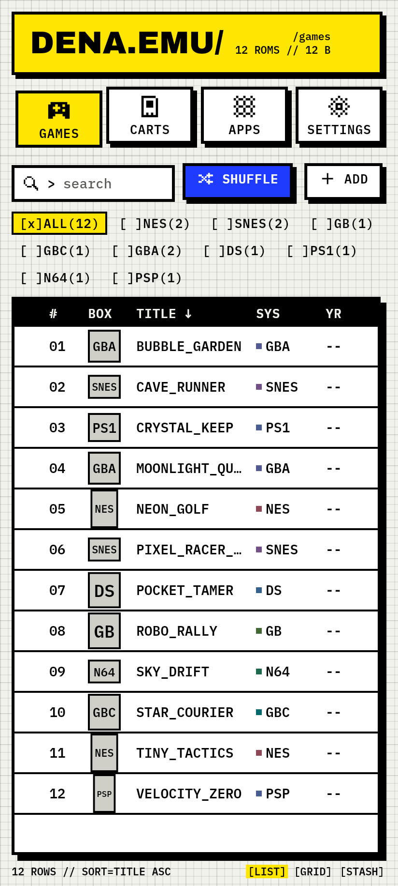
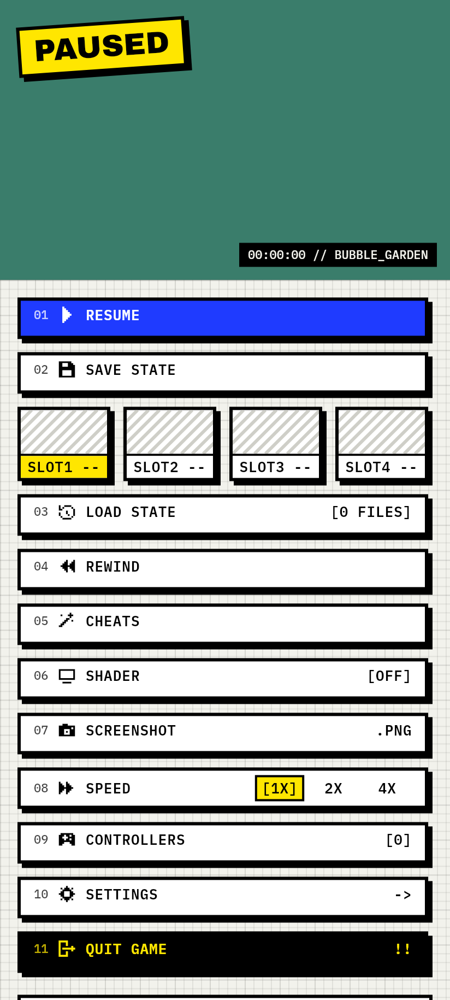
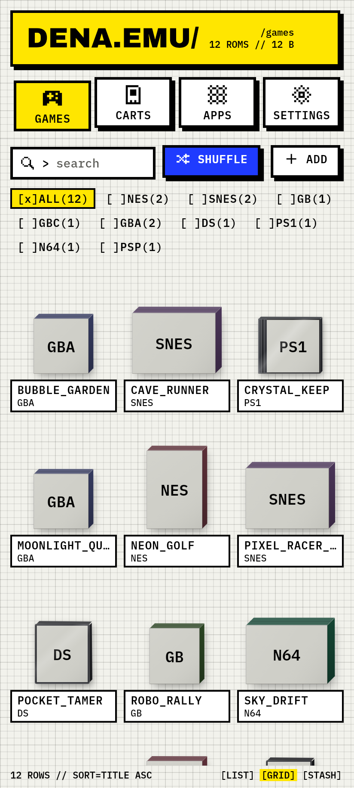
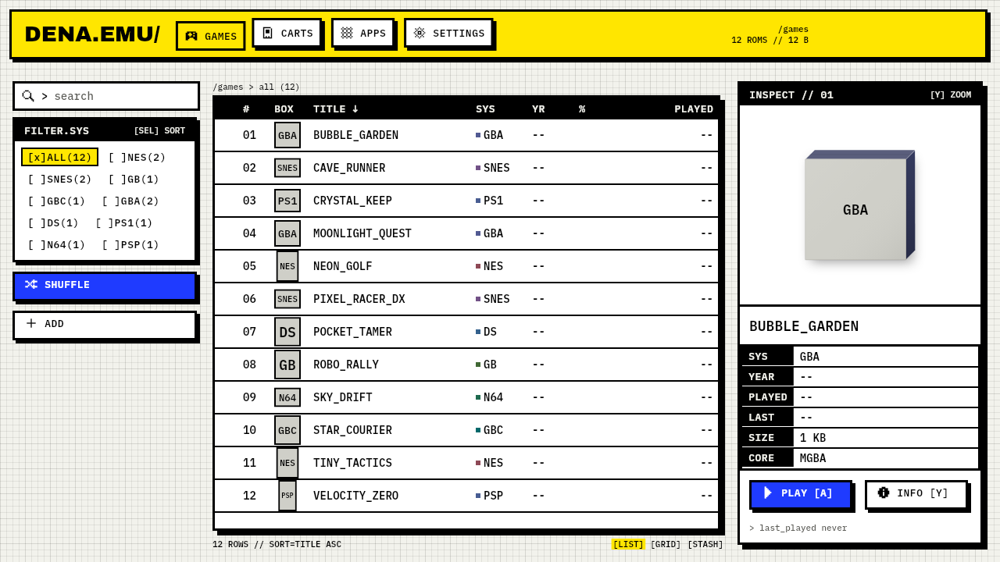
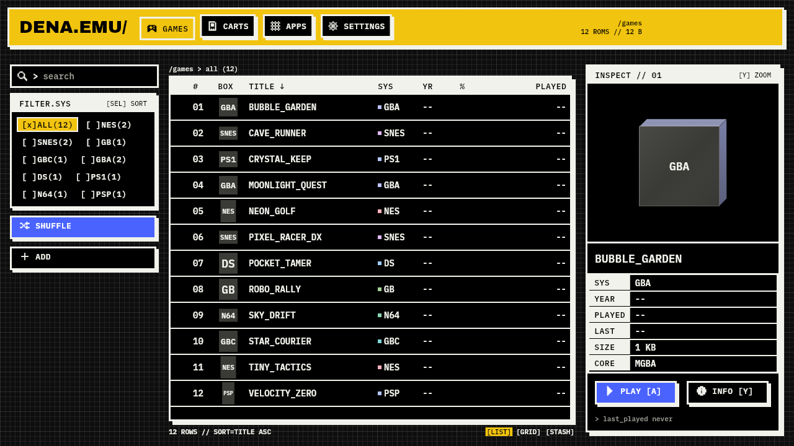
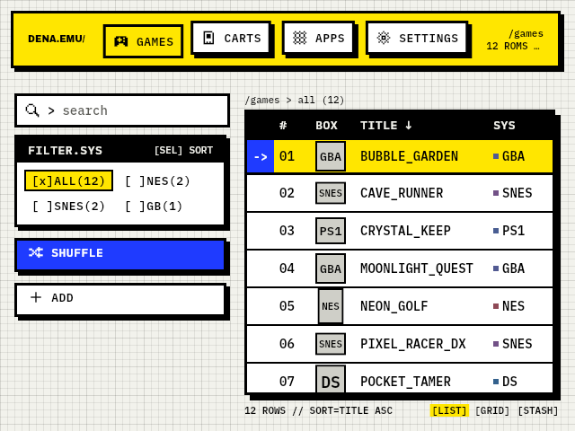
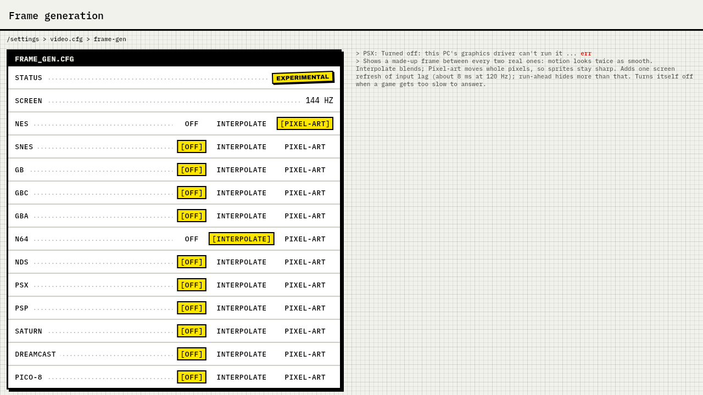
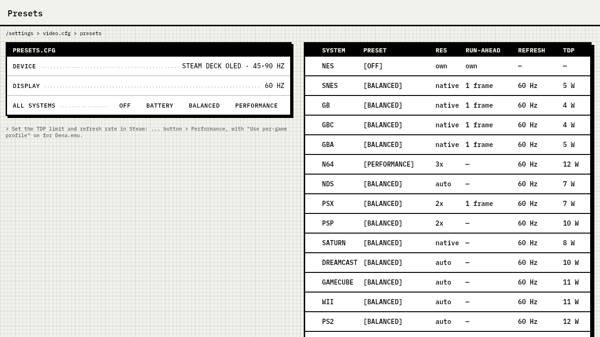
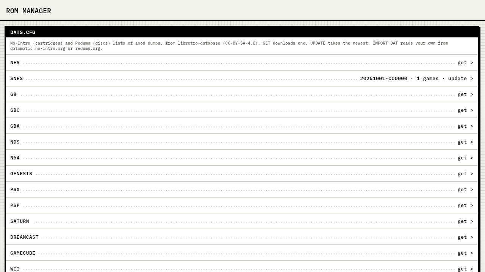

<p align="center"></p>

<h1 align="center">Dena.emu</h1>

<p align="center">
A multi-system emulator for <b>Android</b>, the <b>Anbernic RG35XX SP</b> and
<b>Windows / SteamOS</b>, built as one Flutter app on libretro cores.<br>
Free and open source (GPL-3.0-or-later). No games or BIOS files are included or downloaded.
</p>

<p align="center">
<a href="https://github.com/Denarmo/Dena.emu-Free/releases"><b>Download the latest release</b></a>
</p>

<p align="center">

&nbsp;

&nbsp;

</p>

<p align="center">

</p>

## Download and install

Every release on the [releases page](https://github.com/Denarmo/Dena.emu-Free/releases) has:

| File | For |
| --- | --- |
| `dena-emu-X.Y.Z-arm64.apk` | Android phones and tablets (arm64). Allow installing from your browser or file manager, then open the APK. |
| `Dena-X.Y.Z-rg35xxsp.img.xz` | Anbernic RG35XX SP. Flash it to a microSD card with Raspberry Pi Imager, balenaEtcher or `dd`, then put your games in `Roms/<system>` on the card. |
| `dena-emu-X.Y.Z-windows-x64-setup.exe` | Windows 10/11 installer. SmartScreen may warn on first start, because the build is unsigned. |
| `dena-emu-X.Y.Z-windows-x64-portable.zip` | Windows without installing. Unzip anywhere and run `dena_emu.exe`. |
| `dena-emu-X.Y.Z-x86_64.flatpak` | SteamOS (Steam Deck) and other Linux desktops: `flatpak install --user <file>`. |
| `dena-emu-X.Y.Z-linux-x86_64.tar.gz` | Linux without Flatpak (glibc 2.35 or newer). |
| `SHA256SUMS` | Checksums for all of the above. |

## Systems

| System | Android | RG35XX SP | Windows / SteamOS | Core |
| --- | :---: | :---: | :---: | --- |
| NES | ✓ | ✓ | ✓ | FCEUmm |
| SNES | ✓ | ✓ | ✓ | bsnes |
| Game Boy / Color / Advance | ✓ | ✓ | ✓ | mGBA |
| Nintendo 64 | ✓ | ✓ | ✓ | Mupen64Plus-Next |
| Nintendo DS | ✓ | ✓ | ✓ | melonDS |
| PlayStation | ✓ | ✓ | ✓ | PCSX ReARMed (Android, handheld), Beetle PSX HW (desktop) |
| PSP | ✓ | ✓ | ✓ | PPSSPP |
| PICO-8 | ✓ | ✓ | ✓ | fake-08 runtime with our own Dena Explore launcher cart |
| Sega Saturn | | | ✓ | Beetle Saturn (needs your own BIOS) |
| Dreamcast | | | ✓ | Flycast |
| PlayStation 2 | | | ✓ | LRPS2 (needs your own BIOS) |
| GameCube / Wii | | | ✓ | Dolphin |

The desktop build ships all 12 cores. Every core allows commercial use; see
[docs/licenses.md](docs/licenses.md).

## Features

### Library

- A dense table by default, with a grid and a "stash" view as options; search,
  per-system filters, shuffle, recently played and resume.
- Box art from the bundled OpenVGDB database, fetched on demand, or your own art.
- Import with the system file picker, the built-in file browser, Share / Quick
  Share, a folder on the SD card, or Windows "Open with".
- **File types:** `.zip` (including zipped `.cue` + `.bin` sets), `.chd`,
  `.cue` + `.bin`, `.iso`, `.cso`, `.pbp` and `.p8.png`. PlayStation games
  work as `.chd`, `.pbp` or `.cue` + `.bin`, zipped or not. Files are checked
  before import, so a wrong or broken file is refused with a reason.
- ROM manager (desktop): checks games against No-Intro and Redump lists and
  converts `.cue` sets to `.chd` with your own `chdman`.
- A self-hosted [RomM](https://romm.app) server can be connected to download
  games and sync saves and states.

### Playing

- Auto-save on exit, pause and sleep; resume where you left off.
- Save states with thumbnails, quick save and load, battery saves.
- Rewind, and on desktop a long rewind of several minutes; fast-forward at 2x and 4x.
- Cheats: Game Genie, Action Replay, GameShark and raw codes, toggled in game.
- Screenshots, shaders (CRT, LCD, dot matrix, scanlines, sharp bilinear), and
  on desktop multi-pass slang shader stacks such as CRT-Royale and CRT-Guest-Advanced.
- Desktop: internal resolution scaling and widescreen hacks, **run-ahead** to
  cut input lag, experimental **2x frame generation** on fast displays, and
  HD texture packs.
- [RetroAchievements](https://retroachievements.org): sign in under Settings,
  unlock toasts, hardcore mode and a per-game achievement list.
- **Link cable over Wi-Fi** for Game Boy / Color / Advance between two devices.
- **Netplay** on desktop for NES, SNES and PICO-8 (rollback) and PlayStation,
  N64, Saturn and Dreamcast (lockstep) over the local network.
- Phone external display over HDMI / USB-C.

### Controls

- Touch skins per system and orientation, with `.deltaskin` import (DS dual
  screen included).
- Xbox, DualShock / DualSense, Switch Pro, 8BitDo and generic gamepads, plus
  keyboard. The last input wins: touching hides the focus fill, a button press
  shows it and hides the skin.
- Up to 4 players on Android, 8 on desktop; per-game and per-controller
  remapping with matching button glyphs; controller profiles and gyro aiming
  (Steam Deck, DualSense, DualShock 4, Switch Pro).
- Steam Deck presets: per-system resolution, run-ahead, refresh and TDP, for
  the LCD and OLED models.
- A gamepad at launch on Windows / SteamOS starts fullscreen in controller
  mode, scaled for 1080p and 4K TVs.

### PICO-8

- Cart browser for the Lexaloffle BBS (Featured, New, Search, by author) with
  one-tap download, author, license and BBS link shown for every cart.
- PICO-8 boots into **Dena Explore**, our own launcher cart. Dena.emu is not an
  official PICO-8 product.

### RG35XX SP handheld

- A single-card image: flash it, insert it and boot. The same launcher, library
  and emulator host as the phone app, driven entirely by the D-pad.
- Fixed SD-card layout (`Roms/<system>`, `Bios`, `Saves`, `States`, `Carts`),
  Wi-Fi, a web file manager for uploading games from a browser, USB storage,
  sleep and resume, and safe shutdown that flushes saves.

## Look and feel

The interface is Brutalist: graph-paper background, 3 px black borders, hard
offset shadows, IBM Plex Mono and Archivo Black, and our own 9x9 pixel icons.
Paper (light) and Ink (dark) modes, with a Hazard yellow or Dena gold accent.
Every screen works with touch alone or with a D-pad alone.

<p align="center">

</p>

<p align="center">

&nbsp;

</p>

<p align="center">

&nbsp;

</p>

Screenshots are rendered from the app by
[app/tool/readme_screenshots_test.dart](app/tool/readme_screenshots_test.dart);
the game titles in them are made up.

## Legal

- GPL-3.0-or-later. Every core and dependency is listed with its license in
  [docs/licenses.md](docs/licenses.md); where ideas came from is recorded in
  [docs/provenance.md](docs/provenance.md).
- No ROMs, BIOS files or firmware are included, linked or downloaded. Use games
  you own.
- Not affiliated with any console maker, with Lexaloffle or with the Delta
  emulator. System names are used only to say what the app runs.

## For developers

Project brief and rules: [CLAUDE.md](CLAUDE.md). Specs: [docs/specs](docs/specs).

| Path | What |
| --- | --- |
| `app/` | Flutter app (shared UI) |
| `host/` | C libretro frontend, desktop host library and headless test harness |
| `cores/` | libretro core build scripts |
| `shells/` | Android, Linux and iOS platform shells |
| `os/` | handheld SD-card image builder |
| `tools/` | release, rig, icon, skin and license tools |

```bash
cmake -S host -B host/build && cmake --build host/build && ctest --test-dir host/build
cd app && flutter test
python -m unittest discover -s tools/rig
python tools/licenses/check_licenses.py
```

Release builds: [docs/dev/release-windows.md](docs/dev/release-windows.md),
[docs/dev/release-linux.md](docs/dev/release-linux.md); the SD-card image is
built by `os/image/build.sh`.
